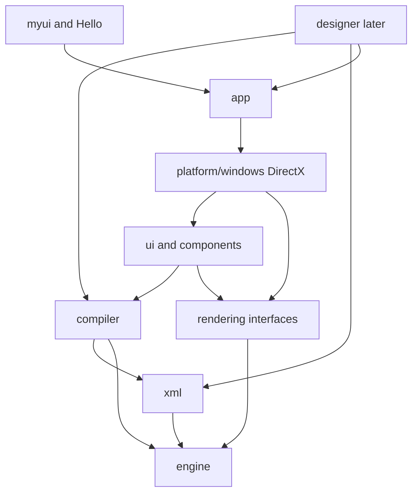

# Module dependency graph

Allowed dependencies:

- `xml` does not include Win32 or DirectX.
- `compiler` does not include the runtime elements or DirectX.
- `ui` depends on the `Renderer` and `TextMeasurer` interfaces, not on Direct3D headers.
- `platform/windows` is the only module that includes `d3d11.h`, `d2d1_1.h`, and `dwrite.h`.
- Tests of the parser, type checker, and layout link `RuntimeUi` and stop there. They do not open a device.
- `Hello` and `myui run` link `RuntimeApp`, which pulls in the DirectX backend.

CMake static libraries follow the same edges: `RuntimeXml`, `RuntimeCompiler`, `RuntimeUi`, `RuntimePlatform`, `RuntimeApp`.
